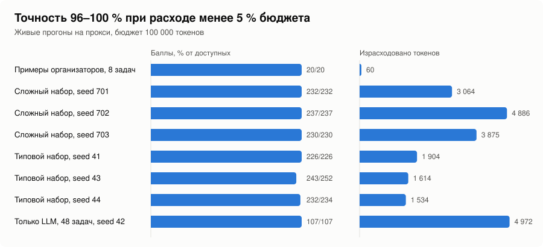
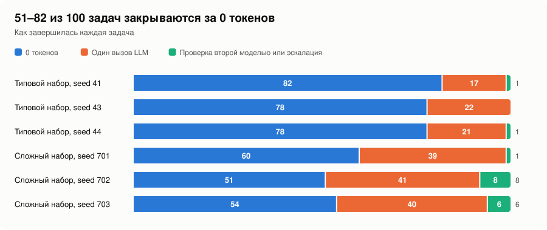
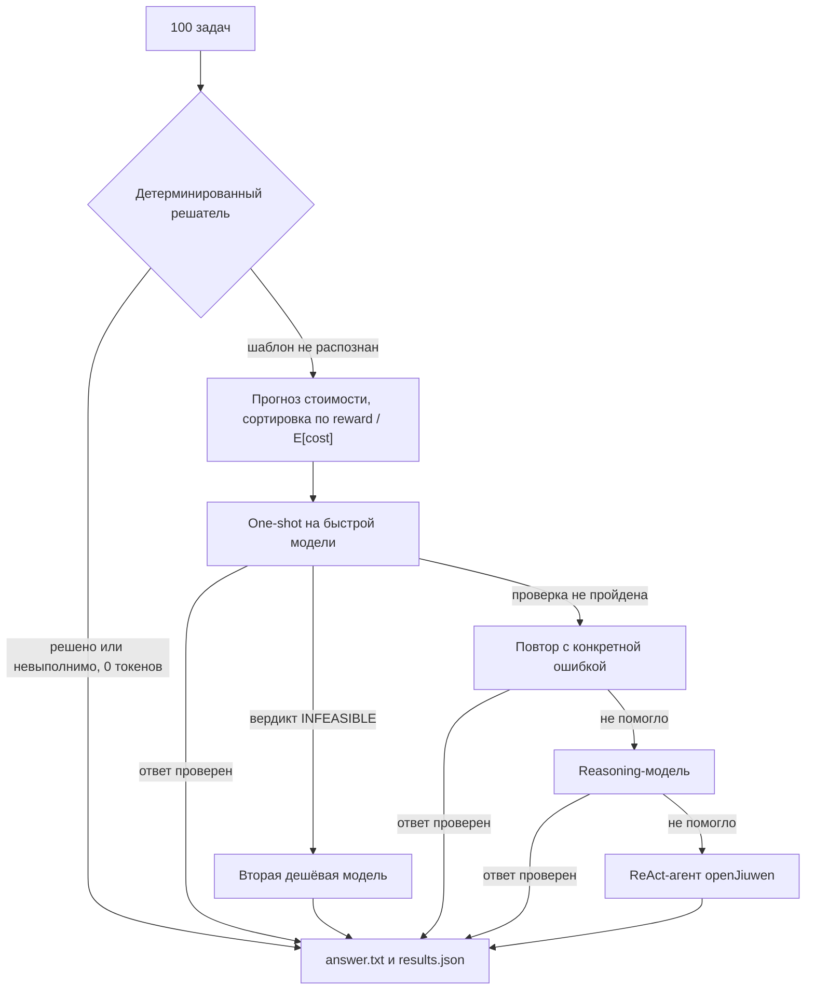
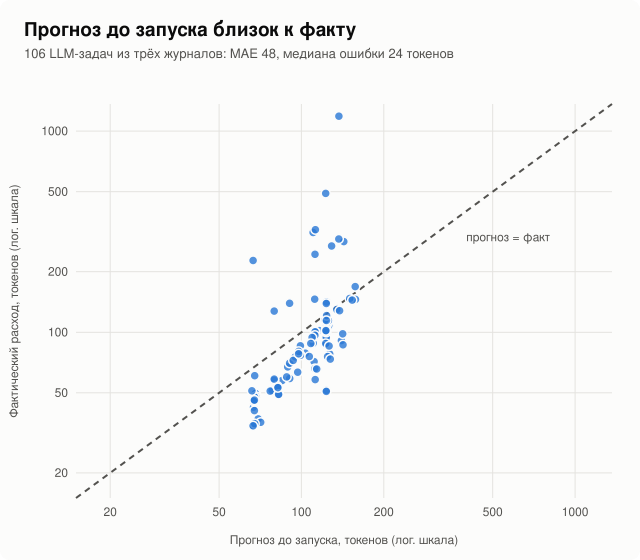

# openJiuwen Challenge 2026 — budget-aware harness

Харнесс на базе **openJiuwen 0.1.20.post1**: получает 100 задач и общий бюджет токенов, заранее оценивает стоимость каждой задачи и набирает максимум баллов при минимальном расходе.

Главная идея: **токен, который не нужно тратить, лучше любого точного прогноза.** Каждая задача сначала проходит через детерминированный решатель за **0 токенов**. LLM подключается только там, где шаблон не распознан: каждый вызов заранее оценён, его стоимость зарезервирована в бюджете, а ответ проверяется локально.

## Результаты

| Прогон | Баллы | Токены | Время |
|---|---|---|---|
| 8 примеров организаторов | **20 / 20** | **60** | 7 с |
| Сложный набор, 100 задач, seed 701 (`trajectories/full_pipeline_hard_seed701.json`) | **232 / 232** | 3 064 | 41 с |
| Сложный набор, 100 задач, seed 702 | **237 / 237** | 4 886 | 48 с |
| Сложный набор, 100 задач, seed 703 | **230 / 230** | 3 875 | 54 с |
| Типовой набор, 100 задач, seed 41 (`trajectories/full_pipeline_run.json`) | 226 / 226 | 1 904 | 28 с |
| Типовой набор, 100 задач, seed 43 | 243 / 252 | 1 614 | 25 с |
| Типовой набор, 100 задач, seed 44 | 232 / 234 | 1 534 | 25 с |
| 48 задач только через LLM, без детерминированного слоя, seed 42 (`trajectories/llm_only_run4_fresh_seed42.json`) | 107 / 107 | 4 972 | 44 с |
| Детерминированный слой, 600 задач, seed 31–33 | 0 неверных ответов, 0 ложных «невыполнимо» | 0 | 7 с на 200 |

Все прогоны выполнены на реальном прокси в контейнере с флагами жюри. Итого на шести полных прогонах (600 задач): **1 400 из 1 411 баллов (99.2 %)** при расходе **менее 5 % бюджета** на прогон. Сложный набор (`tools/gen_hard_tasks.py`) добавляет к шаблонам организаторов незнакомые формулировки, подсчёты и сравнения по базе знаний, coding-задачи с несколькими багами и широкий спектр невыполнимых задач; его seed'ы не использовались при настройке. В coding оценка строже обычного запуска тестов: каждая починенная функция дополнительно сравнивается с эталоном на 200 случайных входах (приближение к скрытым тестам).

<picture>
  <source media="(prefers-color-scheme: dark)" srcset="docs/charts/results_dark.svg">
  
</picture>

<picture>
  <source media="(prefers-color-scheme: dark)" srcset="docs/charts/closed_dark.svg">
  
</picture>

## Сильные стороны

* **До 82 % задач закрывается за 0 токенов.** Детерминированные решатели за секунды закрывают типовые задачи всех четырёх типов; остальные уходят в LLM примерно по 50–190 токенов.
* **Ответ проверяется до записи.** Код модели исполняется, патч прогоняется настоящими тестами задачи, в math число сгенерированных шагов сверяется с числом предложений, а ответ по цепочке отношений обязан дословно встречаться в базе знаний.
* **Защита от починок «под тест».** Без LLM принимается только чистая обратная замена, на которой сошлись все равные кандидаты на случайных входах (см. «Детерминированные решатели»).
* **Вопросы по всей базе знаний.** Подсчёты, обратные связи и сравнения решаются запросом, который пишет модель и исполняет харнесс над всеми записями: модель видит только схему, а результат считает Python.
* **Прогноз до запуска по всей задаче.** MAE 23–50 токенов, а суммарный прогноз практически не занижает факт (от −1 до +35 %), поэтому бюджет планируется с запасом.
* **Невыполнимые задачи почти ничего не стоят.** Большинство распознаётся за 0 токенов, остальные подтверждаются второй дешёвой моделью за ~40–150 токенов.
* **Устойчивость к сбоям.** Ошибка одной задачи или временный сбой прокси не останавливают прогон, ответы сохраняются сразу после решения.
* **Глубокая интеграция с openJiuwen.** `Model`, `ReActAgent`, `tool`, колбэки и штатный `request_force_finish` для остановки по токенам.
* **Готовность к контейнеру жюри.** Работает под `--read-only` и `--cap-drop ALL`, при запуске ничего не скачивает.

## Соответствие регламенту

| Требование | Реализация |
|---|---|
| Харнесс на базе openJiuwen | `openjiuwen==0.1.20.post1`, все вызовы LLM идут через SDK (`harness/llm.py`, `harness/react.py`) |
| Бюджет: вход 10:1, reasoning как выход, кеш не учитывается | `harness/budget.py`: `cost = prompt_tokens / 10 + completion_tokens`, полный учёт по `usage` |
| Оценка расхода заранее, выбор выгодных задач | `harness/estimator.py`, сортировка по `reward / E[cost]` в `harness/scheduler.py`, режим `--predict-only` |
| Невыполнимые задачи: без затрат и без `answer.txt` | раздел «Распознавание невыполнимых задач» |
| Четыре разрешённые модели, переключение на любом вызове | лестница эскалации, `harness/config.py` |
| Не более 5 сессий | `MAX_PARALLEL=4` |
| Локальные нейросети запрещены | не используются, все обращения только к прокси |
| Решения сохраняются после каждой задачи | атомарная запись `answer.txt` и `results.json` (`harness/tasks.py`, `harness/fsutil.py`) |
| Лимит 1 час | новые LLM-шаги не начинаются после `TIME_LIMIT_S=3300` |
| Сеть только к прокси, ничего не скачивается при запуске | tiktoken и HF работают офлайн (`harness/oj.py`) |
| Версии и базовый образ зафиксированы | `python:3.12.7-slim-bookworm`, `requirements.txt`, полный lock `constraints.txt` |
| Нет ключей в репозитории | адрес и ключ приходят только из окружения |
| Образ < 4 ГБ, сборка < 1000 с, репозиторий < 100 МБ | образ **1.07 ГБ**, сборка 49 с при быстром канале (Docker Desktop, macOS), репозиторий менее 1 МБ |

## Сборка и запуск

```bash
docker build -t hack:latest .

mkdir -p "$OUT" && chmod 777 "$OUT"
timeout -k 1000s 1h docker run --rm --name "run-${TEAM}" \
  --network hack-net \
  -e LLM_BASE_URL -e LLM_API_KEY \
  -v "$TASKS:/data/tasks:rw" \
  --read-only --tmpfs /tmp:rw,size=2g -e HOME=/tmp \
  --cap-drop ALL --security-opt no-new-privileges \
  --cpus 8 --memory 16g --pids-limit 512 \
  --workdir /app --entrypoint python \
  "hack:latest" \
  /app/run_agent.py --tasks-dir /data/tasks
```

Локально без Docker:

```bash
pip install -r requirements.txt -c constraints.txt
export LLM_BASE_URL=<адрес прокси> LLM_API_KEY=<ключ>
python run_agent.py --tasks-dir ./task-dir --out results.json
python run_agent.py --tasks-dir ./task-dir --predict-only   # только прогноз, файлы задач не меняются
```

**Выходные файлы.** Ответ пишется в `<task>/answer.txt` рядом с `task.json`, копия — в `<task>/workspace/answer.txt` (в инструкциях задач указан «current directory»). Для невыполнимых задач файл не создаётся. `results.json` перезаписывается атомарно после каждой задачи: ответы, статусы, прогноз и факт расхода, журнал всех LLM-вызовов. Путь берётся из `--out` (синонимы `--output`, `--output-file`, `--solutions`), иначе из `$OUT`, иначе `/tmp/results.json`. Неизвестные флаги логируются и не прерывают запуск.

**Права.** Каталог `$TASKS` должен быть доступен на запись пользователю контейнера. Файлы заменяются через `os.replace`, поэтому достаточно прав на сами каталоги: чужие файлы с правами 0644 не мешают.

| Переменная | По умолчанию | Смысл |
|---|---|---|
| `LLM_BASE_URL`, `LLM_API_KEY` | — | адрес и ключ прокси |
| `BUDGET` | `100000` | бюджет в выходных токенах |
| `BUDGET_SAFETY_FRACTION` | `0.06` | доля бюджета, которая никогда не планируется |
| `MAX_PARALLEL` | `4` | одновременных сессий агента |
| `TIME_LIMIT_S` | `3300` | после этого времени новые LLM-шаги не начинаются |
| `MODEL_FAST` / `MODEL_ALT` / `MODEL_REASON` | `qwen3.8-27b-noreason` / `qwen3.6-35b-a3b-noreason` / `qwen3.8-27b` | модели лестницы |
| `ENABLE_REACT`, `ENABLE_REASONING_MODEL` | `1` | ступени эскалации |
| `ANSWER_IN_WORKSPACE` | `1` | копия ответа в `workspace/` |
| `CODING_DIFF_POLICY` | `strict` | все равные кандидаты-починки должны вести себя одинаково; `plurality`: достаточно строго самого частого поведения |
| `DISABLE_DETERMINISTIC`, `FORCE_REACT` | `0` | для экспериментов и сбора траекторий |

## Архитектура



```
run_agent.py
└── harness/scheduler.py   планировщик и исполнитель
    ├── phase 0  harness/solvers/*       решатели без LLM, 0 токенов
    │            ├─ math_solver.py       разбор задач по предложениям, целочисленная арифметика
    │            ├─ data_solver.py       разбор вопроса в фильтры и агрегаты по CSV
    │            ├─ search_solver.py     KB-граф и цепочка отношений (multi-hop)
    │            └─ coding_solver.py     поиск AST-мутаций, проверка тестами в песочнице
    └── phase 1  нераспознанные задачи: оценка стоимости, сортировка по reward / E[cost]
                 └─ лестница эскалации (каждая ступень резервирует прогноз в Ledger):
                    1. one-shot на qwen3.8-27b-noreason
                    2. повтор с конкретной ошибкой; вердикт INFEASIBLE проверяет qwen3.6-35b-a3b-noreason
                    3. one-shot на reasoning-модели qwen3.8-27b
                    4. ReAct-агент openJiuwen с bash-инструментом
harness/budget.py     Ledger: учёт токенов, резервирование, запас прочности
harness/estimator.py  прогноз расхода до запуска и онлайн-калибровка
harness/llm.py        вызовы через openJiuwen Model, ретраи, разбор HTTP-статусов, circuit breaker
harness/react.py      ReActAgent, колбэки BEFORE/AFTER_MODEL_CALL, force_finish на лимите
harness/fsutil.py     атомарная запись
tools/                генератор задач, оценка баллов, оценка точности прогноза
trajectories/         журналы прогонов на реальном прокси
```

**openJiuwen.** `openjiuwen.core.foundation.llm.Model` с `ModelClientConfig` и `ModelRequestConfig` используется для one-shot и reasoning-ступеней. `openjiuwen.core.single_agent.ReActAgent` запускает агентный цикл с инструментом `bash`, собранным через `openjiuwen.core.foundation.tool.tool`. Длина цикла ограничена `max_iterations`, расход считается колбэком `AFTER_MODEL_CALL`, остановка на лимите идёт через `request_force_finish`. Логи SDK настраиваются до первого импорта (`harness/oj.py`) для работы в read-only контейнере.

### Детерминированные решатели

Каждый решатель возвращает `SOLVED`, `INFEASIBLE` или `UNKNOWN`. Принцип: **лучше отдать задачу LLM, чем уверенно ошибиться**. Шаблоны намеренно узкие: любая незнакомая конструкция даёт `UNKNOWN` и уходит в LLM.

* **math**. Каждое предложение обязано целиком совпасть с шаблоном операции, единица измерения должна совпадать с единицей запаса. Арифметика целочисленная, как в `python3 -c`.
* **data_analysis**. Значения в кавычках становятся фильтрами по колонкам, диапазоны месяцев — фильтрами по месяцу. Поддерживаются суммы, число заказов, revenue, «какой регион/продукт/месяц лидирует» (при ничьей — LLM), экстремум одного заказа, среднее, число различных значений. Любое необработанное слово или число даёт `UNKNOWN`.
* **search**. `kb/*.md` разбираются в граф сущностей. Цепочка отношений строится из притяжательных форм, конструкций «the K of …» и хвостовых глаголов; каждый шаг должен разрешаться в существующую сущность. Подсчёты, обратные связи и сравнения решает запрос над всеми записями KB, который пишет LLM и исполняет харнесс.
* **coding**. Внедрённые баги — это мутации корректного кода, поэтому решатель ищет обратную мутацию по AST и прогоняет кандидатов неизменённым тестовым файлом в отдельном процессе с тайм-аутами. Без LLM починка принимается, только если:
  1. победитель — чистая обратная замена (`+↔-`, `<↔>`, `==↔!=`, `and↔or`, `min↔max`, `sorted↔reversed` и т. п.), а не правка константы, индекса или среза;
  2. все равные по качеству кандидаты прогнаны на ~60 случайных входах той же формы, что и аргументы теста, и ведут себя одинаково.

  Иначе подтверждённая часть сохраняется, а функция уходит в LLM вместе со списком расходящихся кандидатов (~100 токенов). Финальная проверка — настоящая команда задачи. Тесты никогда не изменяются.

## Оценка расхода токенов

Стоимость считается в выходных токенах: `cost = prompt_tokens / 10 + completion_tokens`. Reasoning-токены учитываются как выходные, в каком бы поле их ни вернул провайдер.

**Прогноз до запуска** (`harness/estimator.py`):

1. Для распознанной шаблоном задачи прогноз равен 0.
2. Для остальных промпт собирается до вызова, поэтому вход известен почти точно: `len(prompt) / chars_per_token[type] + 20`, коэффициенты замерены на реальных вызовах (math 3.65, data 2.85, coding 3.2, search 3.0).
3. Выход берётся из априорных оценок по паре (тип, стратегия), подобранных на траекториях; для coding — по размеру кода, который вернёт модель.
4. Ожидаемая стоимость: `E[cost] = cost(one-shot) + (1 − p_success) · (0.5·cost(one-shot) + 0.5·cost(reasoning))`, где `p_success` — бета-апостериорная оценка по ходу прогона.
5. Онлайн-калибровка: множитель `(тип, стратегия)` обновляется через EMA отношения факт/прогноз.

**Точность** (`tools/estimator_eval.py`): прогноз, записанный до запуска задачи, против всего её фактического расхода, на seed'ах вне подбора.

| Прогон | LLM-задач | Средний факт | MAE | Медиана ошибки | Недооценок | Σ прогноз / Σ факт |
|---|---|---|---|---|---|---|
| типовой набор, seed 41 | 18 | 106 | 27 | 20 | 11 % | 2 018 / 1 904 |
| типовой набор, seed 43 | 22 | 73 | 23 | 26 | 5 % | 2 106 / 1 614 |
| типовой набор, seed 44 | 21 | 73 | 25 | 26 | 5 % | 2 040 / 1 534 |
| сложный набор, seed 701 | 40 | 77 | 30 | 27 | 2 % | 4 124 / 3 064 |
| сложный набор, seed 702 | 48 | 102 | 50 | 29 | 10 % | 4 947 / 4 886 |
| сложный набор, seed 703 | 46 | 84 | 37 | 32 | 7 % | 5 055 / 3 875 |
| только LLM, seed 42 | 48 | 104 | 45 | 23 | 15 % | 4 919 / 4 972 |

Ошибка смещена в переоценку, то есть в безопасную для бюджета сторону: задачу недооценивают лишь 2–15 % прогнозов.

<picture>
  <source media="(prefers-color-scheme: dark)" srcset="docs/charts/forecast_dark.svg">
  
</picture>

**Как прогноз используется:**

* **Отбор и порядок.** Баллы не связаны со сложностью, поэтому первыми идут задачи с наибольшим `reward / E[cost]`.
* **Допуск.** Шаг начинается, только если `Ledger.try_reserve(прогноз)` успешен, поэтому параллельные воркеры вместе не выходят за бюджет.
* **Остановка.** ReAct-агент останавливается через `ctx.request_force_finish()`, как только расход достигает лимита задачи (`max(1500, 2.5·прогноз)`) или заканчивается бюджет.
* **Запас.** Последние 6 % бюджета не планируются, запросы с тайм-аутом списываются по пессимистичной оценке.
* **Отчёт.** В `results.json` для каждой задачи есть `predicted_cost`, `predicted_llm_cost` и `actual_cost`. `--predict-only` выдаёт прогноз для новых задач, не трогая их файлы.

## Распознавание невыполнимых задач

| Тип | Распознаётся за 0 токенов |
|---|---|
| math | неуказанное количество («some», «an unknown number», поставки без размера), деление на 0 |
| data_analysis | нет файла, значения нет в колонке, месяц вне 1..12 |
| search | сущности нет в KB, у сущности нет поля, которое есть у сущностей её вида, ссылка на отсутствующую сущность |
| coding | противоречивые тесты, нет файла тестов |

Если задача дошла до LLM, промпт разрешает ответ `INFEASIBLE`. Вердикт подтверждается одним вызовом другой дешёвой модели (`qwen3.6-35b-a3b-noreason`, ~40–150 токенов), и на этом расход прекращается. Если вторая модель находит проверенное решение, ответ записывается. В coding, если исправление дважды чинит упавшие тесты и ломает другой, тесты признаются противоречивыми (~130 токенов).

## Экономия

* **Контекст.** search получает только подграф KB в пределах 3 переходов от сущности из вопроса (обычно 4–6 строк), а для запросов по всей базе — только схему записей. math — только текст задачи. data — сводку CSV: заголовок, 3 строки, диапазоны и значения колонок. coding — только функции, вызываемые упавшими тестами, эти тесты и строки ошибок; харнесс вставляет ответ модели в файл по AST.
* **Формат ответа.** В math модель пишет по одной строке Python на предложение, в data и запросах по KB — короткий скрипт. Арифметику выполняет интерпретатор, а не модель.
* **Шаги.** Основная стратегия — один вызов и локальная проверка. ReAct включается только последней ступенью.
* **Выбор модели.** `-noreason` используется по умолчанию. Reasoning-модель включается, только когда обе дешёвые попытки не дали проверенного ответа и остаётся больше 15 % бюджета.

Средний расход на задачу при работе только через LLM, включая эскалации: search 53, math 67, data 104, coding 190 токенов.

## Надёжность

* 429 — бесплатный ретрай с бэкоффом.
* 402/403 — бюджет исчерпан, LLM-фаза останавливается.
* 400/404/413/422 — падает только этот вызов.
* 5xx и сетевые ошибки — ретраи, после 8 неудач подряд срабатывает circuit breaker.
* Исключение в одной задаче помечает только её как failed, остальные продолжают работу.
* Каждый ответ записывается сразу, поэтому принудительная остановка контейнера не теряет решённое.

## Безопасность

* Ключей в репозитории нет: адрес и ключ прокси приходят только из окружения.
* Сетевые обращения идут только к `LLM_BASE_URL`, логирование и токенизаторы SDK работают офлайн.
* Код модели и команды ReAct-агента выполняются в подпроцессах с `cwd` в каталоге задачи, тайм-аутами и `RLIMIT_CPU`/`RLIMIT_AS`. У bash-инструмента урезанное окружение.
* Тестовые файлы coding-задач не изменяются: содержимое сверяется и при необходимости восстанавливается.

## Траектории и воспроизведение

Организаторы не дают обучающих данных, поэтому наборы собираются генераторами: `tools/gen_tasks.py` (формат примеров, перефразировки, дополнительные операции) и `tools/gen_hard_tasks.py` (незнакомые формулировки, запросы по всей базе, несколько багов в задаче), оба с ~20 % невыполнимых задач. `tools/evaluate.py` считает баллы по правилам регламента, для coding добавляя сравнение с эталоном на 200 случайных входах.

В `trajectories/` лежат журналы реальных прогонов на прокси: каждый LLM-вызов с моделью, ступенью, токенами и стоимостью, а также прогноз и факт по каждой задаче.

| Файл | Режим |
|---|---|
| `full_pipeline_run.json` | штатный режим, типовой набор, seed 41 |
| `full_pipeline_hard_seed701.json` | штатный режим, сложный набор, seed 701 |
| `llm_only_run4_fresh_seed42.json` | только LLM, текущая версия, seed 42 |
| `llm_only_run3_compact.json` | только LLM, по нему подобраны priors |
| `llm_only_run1.json`, `llm_only_run2.json` | только LLM, первая версия промптов |
| `react_only_run.json` | только ReAct-агент: 2–4 итерации, 170–700 токенов на задачу |

```bash
python tools/gen_tasks.py --out /tmp/train --n 100 --seed 1
python run_agent.py --tasks-dir /tmp/train --out /tmp/train.json
python tools/evaluate.py /tmp/train
python tools/estimator_eval.py /tmp/train /tmp/train.json

python tools/gen_hard_tasks.py /tmp/hard 100 701   # сложный набор: OUT N SEED
python tools/make_charts.py                        # графики docs/charts/*.svg
```
